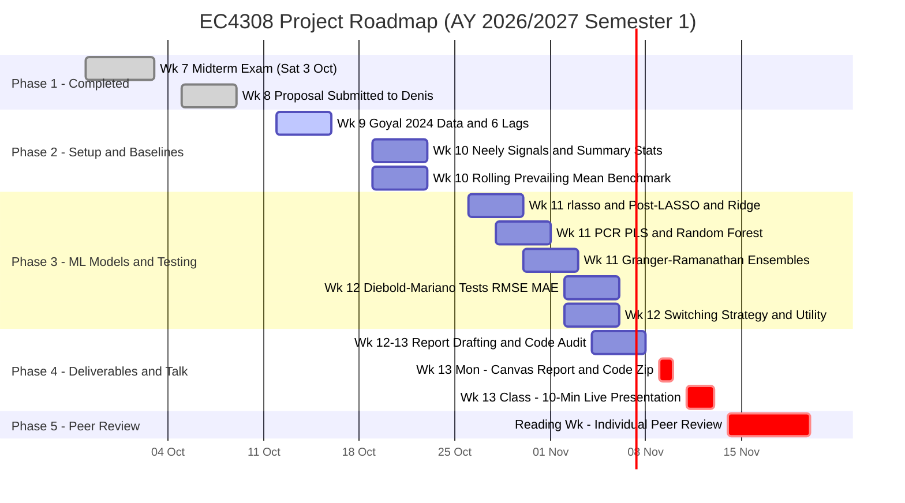

# EC4308 Project Roadmap & Milestones (Post-Feedback Edition)

**Module**: EC4308 – Machine Learning and Economic Forecasting (AY 2026/2027 Sem 1)  
**Topic**: *Forecasting the Equity Risk Premium Out-of-Sample: Regularized ML, Technical Indicators & Tactical Asset Allocation*  
**Instructor**: Prof. Denis Tkachenko  
**Team**: Sasi (Econometrics/Eval) • Vienna (Motivation/Report) • En Shao (ML Models) • Leon (Data/Features)  
**Current Date**: Week 9 (12 Oct – 16 Oct 2026) — *Midterms completed; Proposal feedback received from Prof. Denis.*

---

## 1. Master Schedule (NUS AY 2026/2027 Sem 1)

| Week | Official Dates | Focus & Deliverables | Target Checkpoint |
| :---: | :--- | :--- | :---: |
| **Wk 7** | 28 Sep – 3 Oct | Midterm Exam (Sat 3 Oct, LT13) • Proposal Drafted | `COMPLETED` |
| **Wk 8** | 5 Oct – 9 Oct | 1-Page Proposal Submitted • Feedback Received from Prof. Denis | `COMPLETED` |
| **Wk 9** | **12 Oct – 16 Oct** | **CURRENT**: Expanded Goyal (2024) Data Ingestion • Up to 6 Lags • Rolling Window Scaffold | **16 Oct** |
| **Wk 10** | 19 Oct – 23 Oct | 14 Neely Technical Signals • Table 1 (Summary) • Rolling Prevailing Mean Benchmark | **23 Oct** |
| **Wk 11** | 26 Oct – 30 Oct | `rlasso()`, Post-LASSO, Ridge, PCR, PLS, Random Forest • Granger-Ramanathan Ensembles | **30 Oct** |
| **Wk 12** | 2 Nov – 6 Nov | Diebold-Mariano Tests (RMSE/MAE) • Binary Switching Strategy • Utility & Drawdown • Report Draft | **6 Nov** |
| **Wk 13** | 9 Nov – 13 Nov | **Canvas Submission (Mon 9 Nov)**: Final Report (max 15 pp) + Code Zip Archive<br>**In-Class**: 10-Min Live Presentation (all 4 speak) | **9–13 Nov** |
| **Reading**| 14 Nov – 20 Nov | **Individual Peer Review** of another group on Canvas (5% course grade) | **20 Nov** |

---

## 2. Visual Project Roadmap (Gantt Chart)



---

## 3. Professor Denis's Feedback & Key Methodological Pivots

| Area | Proposal Draft | Prof. Denis's Directive | Final Agreed Design Decision |
| :--- | :--- | :--- | :--- |
| **Primary Benchmark** | OLS & Historical Mean | OLS fails out-of-sample; **Prevailing Mean is the only appropriate benchmark** | The Goyal-Welch Historical Prevailing Mean ($\hat{Y}_{t+h}^{BM} = \frac{1}{t}\sum_{s=1}^t Y_s$) is the primary benchmark to beat. |
| **Window Protocol** | Expanding window | Use **Rolling Window** scheme (fixed $W$) | **Fixed 20-Year Rolling Window ($W = 240$ months)** as standard in Goyal & Welch / Neely et al. |
| **Sample Period** | 1927–2023 | Start later based on full predictor availability in Goyal et al. (2024 RFS) | Download updated data from Amit Goyal (`agoyal145`); set earliest start date with zero missing data across all expanded predictors (targeting ~1947–1952 post-WWII). |
| **Feature Set & Lags** | 1 Lag (14 macro + 14 technical) | Include up to **6 lags** of non-technical macro predictors | Generate $L \in \{1, 2, 3, 4, 5, 6\}$ lags for all macro variables ($X_{t-1}, \dots, X_{t-6}$) + 14 Neely technical indicators ($MA, MOM, OBV$). |
| **LASSO Method** | `glmnet` with 10-fold CV | Use `rlasso()` from `hdm` package (no CV needed; ideal for time series) | Implement theoretical `rlasso()` and **Post-LASSO** (OLS on selected support) from the `hdm` R package. |
| **Evaluation Metrics** | Clark-West (2007) test | Clark-West not in syllabus; use **Diebold-Mariano** on RMSE/MAE | Compare out-of-sample RMSE and MAE against Prevailing Mean using the **Diebold-Mariano (1995)** test; report $R^2_{OOS}$ in master tables and keep Clark-West as an appendix check. |
| **Economic Strategy** | Mean-Variance investor utility ($\Delta U$) | Add a **Binary Switching Strategy** vs Buy-and-Hold index | Hold S&P 500 when $\hat{Y}_{t+h} > 0$; switch to 3-month T-bills when $\hat{Y}_{t+h} \le 0$. Report Terminal Wealth, Sharpe, Max Drawdown net of **10 bps transaction costs** (sensitivity at 5 & 20 bps). |
| **Forecast Ensembles** | Simple 1/N & Bates-Granger | Add **Granger-Ramanathan** forecast combination | Implement **Simple 1/N equal weighting** and **Constrained Non-Negative Granger-Ramanathan** ($\sum w_i = 1, w_i \ge 0$) to avoid extreme leverage. |

---

## 4. Immediate Action Plan (Week 9: 12 Oct – 16 Oct)

* **Leon (Data Lead)**:
  - Download the expanded Goyal, Welch, & Zafirov (2024 RFS) dataset from Amit Goyal's website (`agoyal145`).
  - Scan the missingness matrix to establish the earliest start date with zero missing values (target: ~1947–1952).
  - Engineer up to 6 monthly lags ($t-1, \dots, t-6$) for all macro predictors + the 14 Neely technical indicators.
* **Sasi (Econometrics Lead)**:
  - Code the **240-month fixed rolling window** estimation harness.
  - Implement the Goyal-Welch Historical Prevailing Mean benchmark function.
  - Code the **Diebold-Mariano (1995)** test function for rolling RMSE and MAE comparisons.
  - Build the **Binary Switching Strategy** backtester (tracking portfolio value, Sharpe, Max Drawdown net of 10 bps fee).
* **En Shao (ML Lead)**:
  - Install and verify the `hdm` package in R; test `rlasso()` and post-LASSO syntax.
  - Write rolling estimation template for `glmnet` (Ridge, Elastic Net), `pls` (PCR, PLS), and `ranger` (Random Forest).
  - Implement Constrained Non-Negative Granger-Ramanathan ensembling routine ($\sum w_i = 1, w_i \ge 0$).
* **Vienna (Report Lead)**:
  - Update Section 1 & Section 2 literature references with Goyal, Welch, & Zafirov (2024 RFS).
  - Structure the 15-page report template (11pt font, 1.5 spacing) with dedicated subsections for the Binary Switching Strategy and Granger-Ramanathan ensembling.

---

## 5. Team Ownership Matrix

```
┌───────────────────────────────────────────────────────────────────────────────┐
│                      UPDATED TEAM WORKSTREAM BREAKDOWN                        │
├────────────────────┬────────────────────┬──────────────────┬──────────────────┤
│    Leon (Data)     │   En Shao (ML)     │  Sasi (Testing)  │  Vienna (Report) │
├────────────────────┼────────────────────┼──────────────────┼──────────────────┤
│• Goyal (2024) data │• rlasso & post-    │• Prevailing mean │• Intro & Goyal   │
│• 1 to 6 Macro Lags │  LASSO (hdm pkg)   │  rolling baseline│  (2024) Lit Rev  │
│• 14 Neely signals  │• Ridge & ElasticNet│• Rolling DM test │• Switching & M-V │
│  (MA, MOM, OBV)    │• PCR, PLS, Trees   │  (RMSE & MAE)    │  Economic Story  │
│• Table 1 (Summary) │• Granger-Ramanathan│• Switching Strat │• 15-pp Report &  │
│• Feature plots     │  combination model │  & Wealth/Drawdwn│  Presentation    │
└────────────────────┴────────────────────┴──────────────────┴──────────────────┘
```

### Detailed Deliverable Breakdown

#### Leon — Data & Feature Engineering (Proposal Part 2 Owner)
1. **Data Ingestion**: Download updated Goyal, Welch, & Zafirov (2024) dataset from Amit Goyal's site.
2. **Lag Construction**: Generate 1 to 6 lags for all non-technical macro variables ($X_{t-1}, \dots, X_{t-6}$).
3. **14 Technical Signals**: 6 Moving Average ($MA$), 2 Momentum ($MOM$), 6 Volume ($OBV$) indicators.
4. **Table 1**: Summary statistics (mean, SD, skewness, kurtosis, ADF unit-root tests) across sample period.

#### En Shao — Econometric & ML Methodology (Proposal Part 3 Owner)
1. **`rlasso()` & Post-LASSO**: Implement theoretical data-driven penalty via the `hdm` package (no cross-validation required).
2. **Penalized & Factor Models**: Ridge regression, Elastic Net, PCR, and PLS.
3. **Non-Linear Tree Models**: Random Forest (`ranger`) to capture non-linear interactions across macro lags and technical signals.
4. **Granger-Ramanathan Ensembles**: Fit combination regressions on candidate model forecasts.

#### Sasi — Forecast Evaluation, Significance & Trading Strategies (Proposal Part 4 Owner)
1. **Rolling Window Scheme**: Standardized rolling out-of-sample forecast loop for horizons $h \in \{1, 3, 12\}$.
2. **Prevailing Mean Benchmark**: Historical rolling mean forecast ($\hat{Y}_{t+h}^{BM}$).
3. **Diebold-Mariano Tests**: Formal tests of equal predictive accuracy for RMSE and MAE against the Prevailing Mean.
4. **Binary Switching Strategy**: Hold S&P 500 when $\hat{Y}_{t+h} > 0$; switch to 3-month T-bills when $\hat{Y}_{t+h} \le 0$. Compute Terminal Wealth, Sharpe Ratio, and Maximum Drawdown net of broker transaction costs (e.g. 5–10 bps).
5. **Mean-Variance Investor Utility**: Dynamic asset allocation ($\gamma=3$, weights $\in [0, 1.5]$) and CER gain ($\Delta U$).

#### Vienna — Motivation, Economic Analysis & Paper Lead (Proposal Parts 1 & 5 Owner)
1. **Academic Framing**: Anchor paper around Goyal, Welch, & Zafirov (2024 RFS), Neely et al. (2014), and Gu, Kelly, & Xiu (2020).
2. **Economic Discussion**: Why do technical indicators and lag structures improve downside risk? Analyze recession vs expansion performance.
3. **Document Standards**: Strict 15-page limit, 11pt font, 1.5 line spacing, professional figures and tables.
4. **Presentation**: 10-minute slide deck coordination and timing rehearsal.

---

## 6. Phase-by-Phase Milestones

### Phase 2: Data Pipeline & Baseline Modeling (Weeks 9–10: 12 Oct – 23 Oct)
- [ ] Ingest expanded Goyal et al. (2024) dataset; establish sample start date.
- [ ] Construct 1 to 6 lags for macro predictors and 14 Neely technical indicators.
- [ ] Generate **Table 1 (Summary Statistics & Unit Root Tests)**.
- [ ] Implement Rolling Prevailing Mean benchmark; calculate baseline RMSE and MAE.

### Phase 3: ML Training, Ensembles & Statistical Testing (Weeks 11–12: 26 Oct – 6 Nov)
- [ ] Estimate `rlasso()` and Post-LASSO via `hdm` across rolling windows.
- [ ] Estimate Ridge, Elastic Net, PCR, PLS, and Random Forest (`ranger`).
- [ ] Construct Simple Average and Granger-Ramanathan forecast combinations.
- [ ] Run Diebold-Mariano tests on out-of-sample RMSE and MAE.
- [ ] Backtest the Binary Switching Strategy (Terminal Wealth, Sharpe, Max Drawdown net of transaction costs).
- [ ] Simulate Mean-Variance investor portfolio allocation (CER gain $\Delta U$).
- [ ] Compile **Table 2 & 3 (Master Results)** and **Figures 1–3**.

### Phase 4: Final Deliverables & Presentation (Week 13: 9 Nov – 13 Nov)
- [ ] **Final Report (Mon 9 Nov)**: Max 15 pages in 11pt, 1.5 line spacing (Canvas PDF).
- [ ] **Code Archive (Mon 9 Nov)**: 100% reproducible R scripts + raw data in `.zip` (Canvas).
- [ ] **Live Presentation (Wk 13 Class)**: 10 minutes (all 4 speak) + Q&A.
- [ ] **Peer Review (Reading Week: 14–20 Nov)**: Individual evaluation on Canvas (5%).

---

## 7. Course Rubric & Feedback Tripwires
- **Prevailing Mean is Benchmark**: Do not benchmark against OLS. The Prevailing Mean is the benchmark to beat.
- **R Only**: Entire project coded in R (`hdm`, `glmnet`, `pls`, `ranger`, `forecast`, `sandwich`).
- **Rolling Window Scheme**: Keep training window length fixed; roll forward at each monthly step.
- **Diebold-Mariano Test**: Test significance of RMSE/MAE differences against the Prevailing Mean.
- **Economic Evaluation Net of Costs**: Evaluate both Binary Switching Strategy and Mean-Variance Utility with explicit transaction fee assumptions.
- **Page & Format Limit**: Strictly $\le 15$ pages, 11pt font, 1.5 line spacing.
