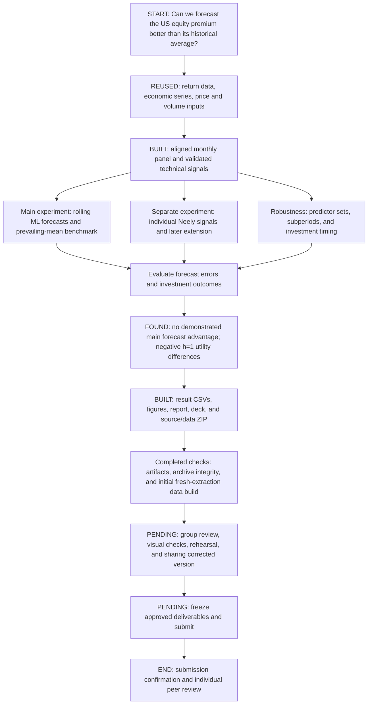
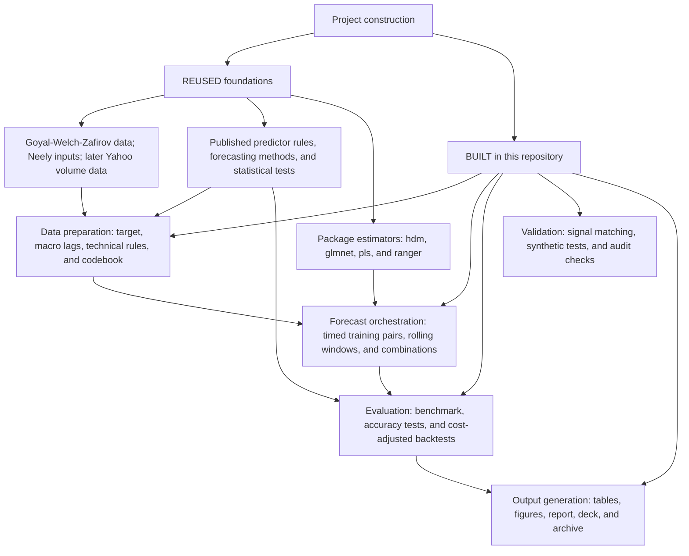
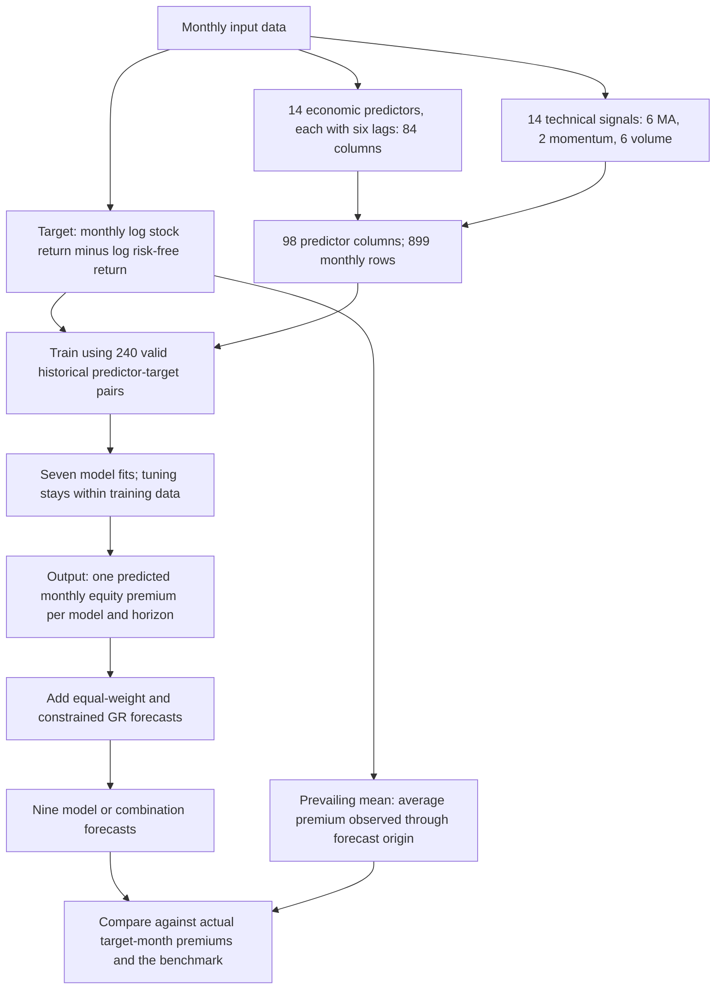
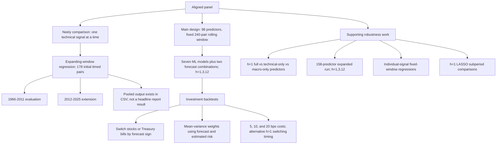
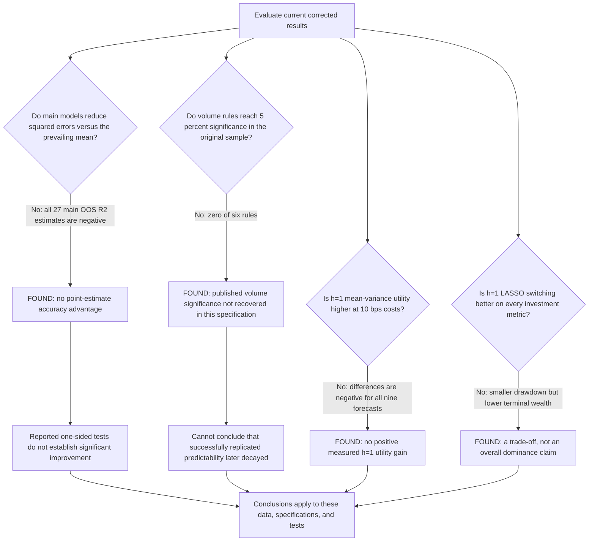
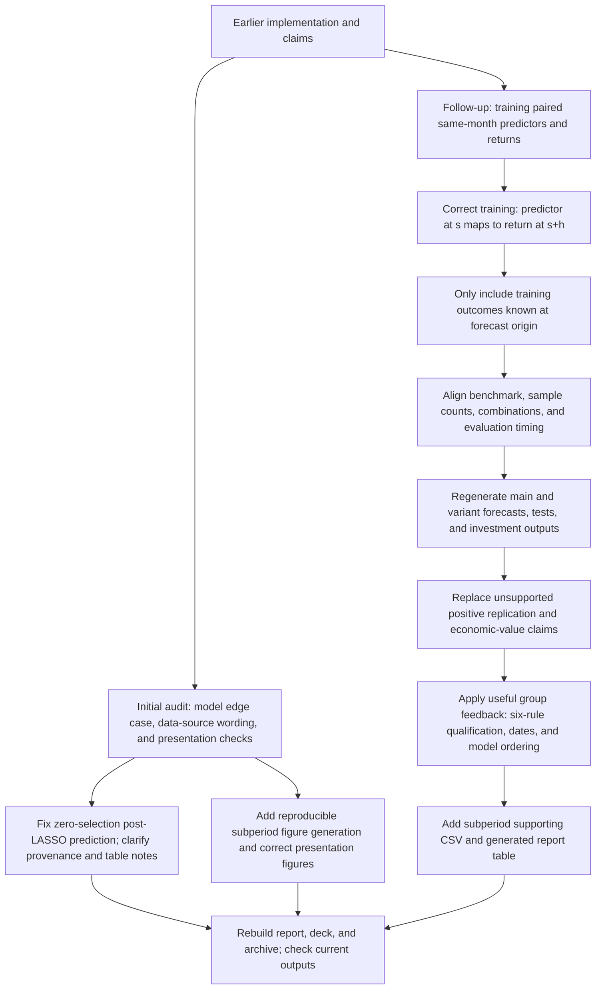
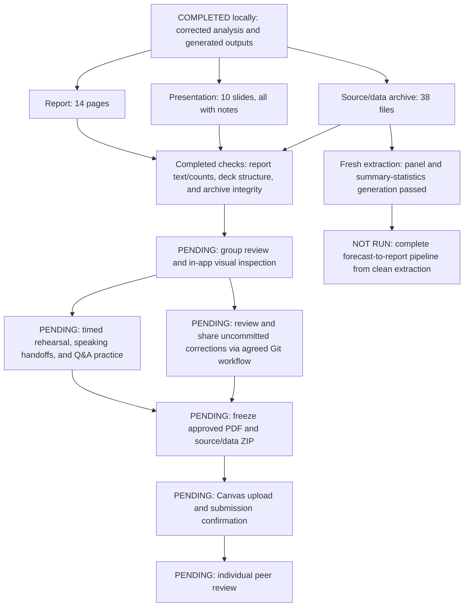

# Project map: from research question to submission

> **Historical map:** this and its HTML rendering predate the code audit.
> Current cash units, simple-return target, chronological tuning and eligible
> expanded set are documented in [README](../README.md). Do not use the old
> map as verification of corrected outputs or report/presentation readiness.

**Purpose:** understand what this repository builds, what it reuses, what it
finds, and what is still outstanding. Read the overview first, then follow
the smaller trees below.

**Snapshot: 3 November 2026.** This describes the corrected local working
tree, including uncommitted changes. It does not certify the version on
GitHub or a Canvas submission.

The project is a connected workflow, not one long sequence of yes/no choices.
Arrows show dependencies; diamonds show the research questions. Parallel
branches are different experiments, not additional steps every model follows.

**Legend:** `REUSED` = external data, published method, or package;
`BUILT` = project-specific implementation/integration;
`FOUND` = current empirical result;
`PENDING` = work not confirmed complete.

To see the diagrams, open this file in a Markdown preview that supports
Mermaid, such as GitHub's file preview. If a viewer only displays code,
the headings, tables, and explanations still provide the same outline.

## 1. The entire project at a glance

**One-sentence takeaway:** we built a forecasting and evaluation pipeline;
under the tested specifications, its complexity did not deliver a demonstrated
forecast advantage or positive h=1 mean-variance utility differences.

## 2. What was built here, and what was not invented here?

**"Built from scratch" needs a qualification.** The repository contains custom
pipeline code and implementations of published rules/tests, but the datasets
and algorithms are not new inventions. Several estimators are fitted by
existing packages. This map identifies code responsibilities, not who authored
each line or an exact commit-by-commit development chronology.

| Repository-built surface | Main evidence |
|---|---|
| Data preparation, target construction, predictor lags | [Panel builder](../data/01_build_panel.R), [data conventions](../data/README.md) |
| Moving-average, momentum, and volume signals | [Technical rules](../R/06_technical_indicators.R) |
| Summary statistics and signal validation | [Summary-statistics generator](../data/02_table1.R), [signal comparison](../data/03_validate_signals.R) |
| Rolling forecasts and package integration | [Rolling harness](../R/01_rolling_window.R), [model wrappers](../R/08_models.R), [runner](../R/09_run_models.R) |
| Benchmark and combined forecasts | [Prevailing mean](../R/02_prevailing_mean.R), [combinations](../R/10_combine_forecasts.R) |
| Statistical and investment evaluation | [DM test](../R/03_diebold_mariano.R), [switching](../R/04_switching_strategy.R), [utility](../R/05_mv_utility.R), [CW test](../R/12_clark_west.R), [evaluation runner](../R/11_evaluate.R) |
| Figures, tables, and presentation generation | [Figure generator](../R/13_figures.R), [LaTeX tables](../R/14_make_latex_tables.R), [deck generator](../deck/make_deck.py) |
| Synthetic checks and submission packaging | [Model smoke tests](../R/98_smoke_models.R), [synthetic alignment tests](../R/99_demo_synthetic.R), [ZIP builder](../scripts/make_submission_zip.R) |

## 3. What enters the models, and what comes out?

- **Target:** `100 * [log(1 + stock return) - log(1 + risk-free return)]`,
  in monthly percentage points.
- **Output:** a number such as `+0.50`, meaning approximately 0.50 percentage
  points of stock outperformance in the target month. This is an illustration,
  not an actual saved forecast. It is not a probability, price, or buy/sell label.
- **Horizons:** h=1, h=3, and h=12 predict one month's premium that many months
  ahead. **h=12 is not the cumulative return over the next year.**
- **Models:** LASSO, post-LASSO, Ridge, Elastic Net, PCR, PLS, and Random Forest;
  plus equal-weight and constrained Granger-Ramanathan combinations.
- **Benchmark:** an expanding historical average. Its value is not calculated
  from only the ML model's 240-pair rolling window.

| Main ML evaluation | First target | Last target | Forecasts |
|---|---|---|---:|
| h=1 | March 1971 | December 2025 | 658 |
| h=3 | July 1971 | December 2025 | 654 |
| h=12 | January 1973 | December 2025 | 636 |

The full input panel starts in February 1951. Training uses the earlier
observations; this is why the evaluation does not start in 1951.
See the [configuration](../R/00_config.R) and saved forecasts for
[h=1](../data/processed/forecasts_h1.csv),
[h=3](../data/processed/forecasts_h3.csv), and
[h=12](../data/processed/forecasts_h12.csv).

## 4. Which experiments and additions were implemented?

**Do not mix these designs:** the Neely regressions are not the same experiment
as the rolling multivariate ML models. Original-period signal matching and
predictive significance are also different checks.

| Addition | Purpose and evidence |
|---|---|
| Fixed-window individual signals | [Bivariate robustness runner](../R/15_neely_bivariate.R) |
| Expanding Neely comparison, extension, and pooled output | [Replication runner](../R/16_neely_replication.R), [results CSV](../output/tables/table5_neely_replication.csv) |
| Technical-only and macro-only variants | [Runner options](../R/09_run_models.R), [generated comparison table](../output/tables/tableA1_tex.tex) |
| Expanded predictor set | [Configuration](../R/00_config.R), [expanded summary](../data/processed/expanded_variant_summary.csv) |
| Three descriptive LASSO subperiods | [Subperiod CSV](../output/tables/table_subperiods_h1.csv), [figure/table source](../R/13_figures.R) |
| Alternative h>1 investment timing | [Overlap strategy implementation](../R/17_switching_overlap.R) |

## 5. What did we find?

### Results to remember

| Question | Current finding | Evidence |
|---|---|---|
| How closely do computed signals match the published series? | 99.98% of signal-months; matching inputs is not matching predictive significance. | [Signal validation](../output/tables/signal_validation.csv) |
| Does any main forecast have positive OOS R2? | No. Across 27 model/horizon estimates, the range is about -15.49% to -0.38%. | Accuracy CSVs: [h=1](../output/tables/table2_h1.csv), [h=3](../output/tables/table2_h3.csv), [h=12](../output/tables/table2_h12.csv) |
| Which tested model is closest to the benchmark? | LASSO at h=1: -1.06%; post-LASSO at h=3: -0.38%, and h=12: -0.52%. | Same accuracy CSVs |
| What about the three focal original-period volume rules? | VOL(2,9): +0.19%, p=0.193; VOL(2,12): +0.11%, p=0.247; VOL(3,12): +0.53%, p=0.077. None of all six volume rules reaches 5%. | [Neely results](../output/tables/table5_neely_replication.csv) |
| Does h=1 LASSO switching beat buy-and-hold? | Wealth per $1: $232.7 vs $341.9; maximum drawdown: -44.4% vs -50.2%, at baseline costs for switching. | [Economic results](../output/tables/table3_h1.csv) |
| What is the h=1 net mean-variance utility difference at 10 bps? | LASSO -0.39% p.a.; post-LASSO -2.07%; GR -0.99%. All nine forecast differences are negative. | [Economic results](../output/tables/table3_h1.csv) |
| Do predictor-set variants overturn the main picture? | All nine h=1 OOS R2 estimates are negative for full, technical-only, and macro-only sets. All 27 expanded-run estimates are negative too. | [Predictor-set table](../output/tables/tableA1_tex.tex), [expanded summary](../data/processed/expanded_variant_summary.csv) |
| Does h=1 LASSO vary across periods? | OOS R2: -0.63% in 1971-1999, -1.20% in 2000-2011, -1.94% in 2012-2025. | [Subperiod results](../output/tables/table_subperiods_h1.csv) |

**Interpretation guardrails**

- An OOS R2 of -1.06% means about 1.06% more total squared error than the
  benchmark, not a predicted investment return of -1.06%.
- Negative point estimates do not by themselves prove statistically significant
  inferiority. The reported tests ask about improvement.
- Utility differences compare the forecast-driven allocation with the
  prevailing-mean-driven allocation, not directly with buy-and-hold.
- A negative utility difference does not mean the portfolio lost money in
  absolute terms.
- Subperiod differences do not identify causes such as crises, passive flows,
  or arbitrage speed. The results do not prove ML never works in finance.

## 6. What did the audit change?

This is a conceptual audit history, not a claim that every branch was performed
in the exact order drawn. The original audit's PASS summary is historical and
was superseded by the timing correction.

| Superseded or unsupported interpretation | Current interpretation |
|---|---|
| Selected volume rules successfully reproduce 5% significance | Three focal estimates are positive; none of six volume rules is significant at 5%. |
| Predictability was replicated and then disappeared | Our original-period specification does not recover the significance, so this decay conclusion does not follow. |
| Positive h=1 mean-variance gains around 1.2-1.3% p.a. | Verified baseline differences are negative, including LASSO -0.39% and post-LASSO -2.07%. |
| Negative R2 establishes statistically significant inferiority | It establishes larger sample squared errors; the reported improvement tests do not establish significant improvement. |
| Crisis months or market-structure changes explain the results | Those mechanisms were not identified by these descriptive comparisons. |

Historical context is in the [audit report](AUDIT_REPORT.md).
The corrected [harness](../R/01_rolling_window.R),
[benchmark](../R/02_prevailing_mean.R), and
[replication script](../R/16_neely_replication.R) are the implementation evidence.

## 7. What exists now, and what remains?

| Deliverable or check | Current evidence/status |
|---|---|
| Written report | [PDF](../report/main.pdf), [LaTeX source](../report/main.tex); 14 pages, within the 15-page limit |
| Presentation and spoken explanation | [Deck](../deck/EC4308_Presentation.pptx), [script](../deck/speaker_scripts.md), [build brief](../deck/SLIDE_SPEC.md); 10 slides with notes |
| Analysis outputs | [Tables](../output/tables/), [figures](../output/figures/), [processed data](../data/processed/) |
| Source/data submission archive | [ZIP](../submission/EC4308_Project_Submission.zip); 38 files, integrity checked. Generated PDF/PPTX are not included. |
| Fresh-extraction check | Initial panel and summary-statistics scripts passed during this session; the temporary extraction was removed. This is not a complete clean-room rerun. |
| Human decisions | Confirm names/contributions, narrative, visual layout, speaking roles, and reviewer sign-offs. Do not mark these complete from automated checks. |
| Sharing and submission | Corrections remain in the local working tree. GitHub synchronization and Canvas submission are not certified by this map. Follow the [submission checklist](../SUBMISSION_CHECKLIST.md). |

**For the group meeting:** first agree on the corrected findings, then assign
review/sign-off responsibilities and rehearse. A negative research finding is
still a finding; do not replace it with an unsupported positive story.

This document adds an explanation only. It does not change the analysis or
certify a grade, a full clean-extraction reproduction, or human sign-off.
